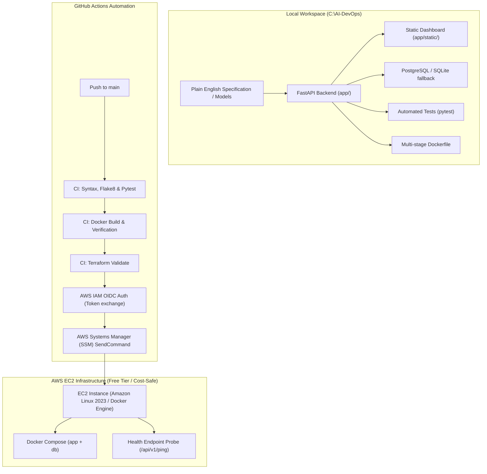

# AI-DevOps System Architecture

## Overview
This platform implements an autonomous, end-to-end DevOps automation lifecycle designed to deploy containerized services to AWS EC2 without hardcoding secrets, requiring SSH keys, or incurring unnecessary cloud costs.

## Core Components

### 1. Application Layer (`app/`)
- **FastAPI Framework:** High-performance asynchronous REST API.
- **SQLAlchemy ORM:** Relational mapping supporting PostgreSQL in production and SQLite in isolated test environments.
- **Pydantic v2:** Rigorous request and response schema validation.
- **Embedded Frontend:** Responsive dark-mode dashboard providing live service health monitoring, DevOps task pipeline tracking, and deployment auditing.

### 2. Containerization Layer (`Dockerfile`, `docker-compose.yml`)
- **Multi-Stage Build:** Builder stage installs compiled wheels; runner stage runs as an unprivileged non-root user (`appuser`).
- **Health Checks:** Native container health check polling `/api/v1/ping`.
- **Docker Compose:** Manages service orchestration with PostgreSQL 16 container, network isolation, and health-dependent startup sequencing (`condition: service_healthy`).

### 3. Infrastructure as Code (`terraform/`)
- **Cost-Protected Compute:** Defaults to `t3.micro` or `t2.micro` instances.
- **Zero-SSH Ingress:** All remote instance management is handled via **AWS Systems Manager (SSM)**. Port 22 is closed to the internet, eliminating brute-force attack vectors.
- **OIDC Identity Federation:** GitHub Actions authenticates directly with AWS via OpenID Connect (OIDC), assuming an IAM role using cryptographic web identity tokens without long-lived access keys.

### 4. Continuous Integration & Continuous Deployment (`.github/workflows/`)
- **CI Workflow (`ci.yml`):** Runs syntax validation, linting, 100% test coverage check, Docker build verification, and Terraform validation.
- **CD Workflow (`cd.yml`):** Triggers on push to `main`, assumes deployment role via OIDC, executes container update on the EC2 instance via AWS SSM, and tests the live `/api/v1/ping` health check.
